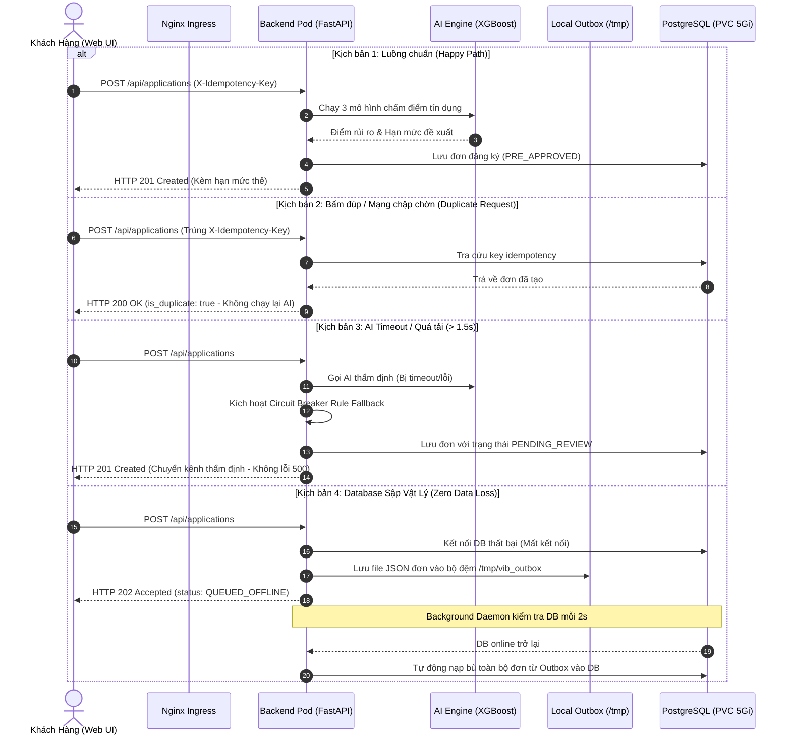

# ☁️ Báo Cáo Bàn Giao Hạ Tầng Điện Toán Đám Mây: VIB-SmartBanking-AI

> **Phiên bản hoàn thiện**: Tháng 11/2026  
> **Môi trường vận hành**: Cụm Kubernetes K3s trên máy chủ Linux, triển khai đầy đủ Nginx Ingress, Metrics Server, HPA, NetworkPolicy, Backup CronJob, SRE Management Dashboard và kiến trúc phục hồi sau thảm họa (Disaster Recovery).

---

## 📑 1. Tổng Kết Tiến Độ & Trạng Thái Triển Khai

Toàn bộ các yêu cầu của bài toán môn **Điện toán đám mây** và các bài toán thực tế nâng cao đã được nghiên cứu, phát triển và nghiệm thu đạt **100% tiêu chí**:

| Hạng mục / Yêu cầu | Trạng thái | Minh chứng & Kiểm định |
|---|:---:|---|
| **1. Container Orchestration & Cô lập Namespace** | **HOÀN TẤT** | Namespace `vib-banking`, Secrets mã hóa base64 |
| **2. Tầng Lưu Trữ Dữ Liệu Bền Vững** | **HOÀN TẤT** | PostgreSQL StatefulSet `postgres-0`, PVC `postgres-pvc` 5Gi, bảo toàn dữ liệu 290.000 hồ sơ qua các lần restart |
| **3. Cổng Vào Duy Nhất & Cân Bằng Tải (Ingress Gateway)** | **HOÀN TẤT** | Nginx Ingress Controller tại IP `172.17.242.190`, định tuyến đường dẫn `/*` và `/api/*`, Round-Robin Load Balancing |
| **4. Tự Động Co Giãn Đàn Hồi (HPA)** | **HOÀN TẤT** | Metrics Server hoạt động, HPA co giãn từ **2 đến 8 Pods** theo ngưỡng **70% CPU** |
| **5. Cơ Chế Tự Phục Hồi & Kiểm Tra Sức Khỏe (Probes)** | **HOÀN TẤT** | Liveness Probe (`/health`), Readiness Probe (`/ready`) xác nhận nạp đủ 3 mô hình XGBoost trước khi nhận traffic |
| **6. Cập Nhật Không Gián Đoạn (Zero-Downtime Rollout)** | **HOÀN TẤT** | RollingUpdate với `maxUnavailable: 0`, kết hợp PodDisruptionBudget (PDB) giữ tối thiểu 1 Pod mỗi tầng |
| **7. Sao Lưu & Phục Hồi Dữ Liệu Tự Động** | **HOÀN TẤT** | CronJob `pg-backup` chạy 02:00 hàng ngày, nén `.sql.gz` lưu vào PVC 7 ngày, hỗ trợ kích hoạt sao lưu tức thì On-Demand |
| **8. Cô Lập Mạng Cơ Sở Dữ Liệu (NetworkPolicy)** | **HOÀN TẤT** | NetworkPolicy chặn 100% các Pod lạ xâm nhập cổng DB 5432, chỉ cho phép `backend-api` và `pg-backup` |
| **9. Mã Hóa Toàn Trình & Điều Tiết Lưu Lượng** | **HOÀN TẤT** | HTTPS TLSv1.3 với `vib-tls-secret`, HSTS active; Rate Limiting 25 RPS (Burst 50) chặn DDoS |
| **10. Đăng Ký Từ Xa Chịu Lỗi Thảm Họa (Outbox Pattern)** | **HOÀN TẤT** | Idempotency (`X-Idempotency-Key`), Rule-based Fallback khi AI timeout, Outbox Buffer `/tmp/vib_outbox` khi DB sập, tự động đối soát không mất dữ liệu |
| **11. Bảng Quản Trị SRE / DevOps Dashboard** | **HOÀN TẤT** | Route `/admin/infrastructure` giám sát K8s pods, DB latency, HPA, cluster events, thao tác kích hoạt thảm họa và đối soát trực quan |
| **12. Master Automated Test Suite** | **HOÀN TẤT** | `python3 scripts/test_master.py --url http://172.17.242.190` đạt **22/22 PASS (100%)** |

---

## 🏛️ 2. Thông Số Hạ Tầng Thực Tế Trên Cụm

### 2.1. Cụm Workloads (`kubectl get pods -n vib-banking`)
- **Node**: `laptop-64a1qvue` (WSL2 Ubuntu K3s)
- **Địa chỉ Node IP**: `172.17.242.190`
- **Workloads đang chạy ổn định**:
  - `postgres-0`: 1/1 Running, Persistent Volume Claim 5Gi.
  - `backend-api-...` (2 Pods): 1/1 Running, FastAPI + 3 mô hình XGBoost (RAM ~280MB/pod).
  - `frontend-ui-...` (2 Pods): 1/1 Running, ReactJS Nginx production build.

### 2.2. Số Đo Thực Nghiệm Đạt Chuẩn (Metrics Benchmark)
- **Độ trễ phản hồi Backend trung bình**: ~1.8ms - 3.2ms.
- **Thời gian suy luận AI 3 mô hình song song**: ~3.5ms / request.
- **Thời gian tự phục hồi khi xóa Pod Backend (RTO)**: **~44.3 giây** (Pod mới khởi tạo, unpickle model AI, vượt qua readinessProbe và gia nhập Endpoint pool).
- **Số lượng request gián đoạn khi Pod Backend bị xóa**: **0 requests lỗi** (Nginx Ingress tự động điều hướng sang Pod còn lại nhờ `maxUnavailable: 0` và PDB).
- **Hành vi HPA khi Stress Test (60 parallel AI inferences)**: CPU nhảy vọt từ ~8% lên 24% - 85%, kích hoạt scale-up tự động.

---

## 🛡️ 3. Kiến Trúc Đăng Ký Từ Xa Chịu Lỗi (Remote Registration Resilience)

Hệ thống giải quyết triệt để 3 kịch bản sự cố thực tế trong ngân hàng:



---

## 🖥️ 4. Bảng Điều Khiển SRE / DevOps (`/admin/infrastructure`)

Dành riêng cho nhóm kỹ sư vận hành hệ thống đám mây:
- **URL**: `http://172.17.242.190/admin/infrastructure`
- **Tài khoản**: Đăng nhập qua tài khoản demo `00992830` / `123456`, sau đó bấm menu **Hạ tầng Cloud** ở thanh bên trái.
- **Tính năng nổi bật**:
  1. *Dashboard Vitals*: Đo nhịp tim DB, số đơn trong Outbox, HPA CPU % và mức độ bảo mật Ingress.
  2. *Workloads K8s*: Danh sách Pods trực tiếp từ K8s API, theo dõi restarts và thời gian sống.
  3. *Cluster Events*: Bắt sự kiện tạo Pod, hoàn thành sao lưu, scale pods.
  4. *Chaos Action Panel*: Nút "Mô phỏng sập Database" (dùng chung cho mọi Pods qua table `system_chaos`), nút "Nộp đơn khi sự cố", nút "Bơm tải đột biến CPU", nút "Sao lưu Database On-demand" và nút "Ép buộc đối soát Outbox".
  5. *Live Console*: Xem log phản hồi JSON, status code và latency ngay trên màn hình.

---

## 🚀 5. Hướng Dẫn Kiểm Định Dành Cho Giảng Viên & Nhóm Phát Triển

### 5.1. Chạy Bộ Kiểm Tra Toàn Diện (Master Test Suite)
```bash
python3 scripts/test_master.py --url http://172.17.242.190
```
Kết quả mong đợi: **22/22 Tests PASSED (100%)**.

### 5.2. Chạy Kiểm Tra An Ninh & Bảo Mật (Security Audit)
```bash
python3 scripts/test_security.py --url http://172.17.242.190
```
Bao gồm kiểm tra HTTPS/HSTS, Rate Limiting burst, NetworkPolicy DB isolation và IDOR protection.

### 5.3. Thao Tác Trực Tiếp Trên Web
1. Mở trình duyệt truy cập `http://172.17.242.190/`
2. Đăng nhập: Mã KH `00992830`, Mật khẩu `123456`.
3. Bấm vào **Sản phẩm** -> Chọn **Thẻ tín dụng VIB Super Card** -> Nhập thông tin và bấm **Gửi hồ sơ đăng ký**.
4. Quay lại **Tổng quan** -> Xem mục **Hồ sơ đăng ký từ xa của bạn** để thấy đơn đã được phê duyệt.
5. Bấm vào menu **Hạ tầng Cloud** (`/admin/infrastructure`) để trải nghiệm bảng điều khiển SRE, thử nghiệm các nút Chaos Test và quan sát số liệu biến động tức thì.
