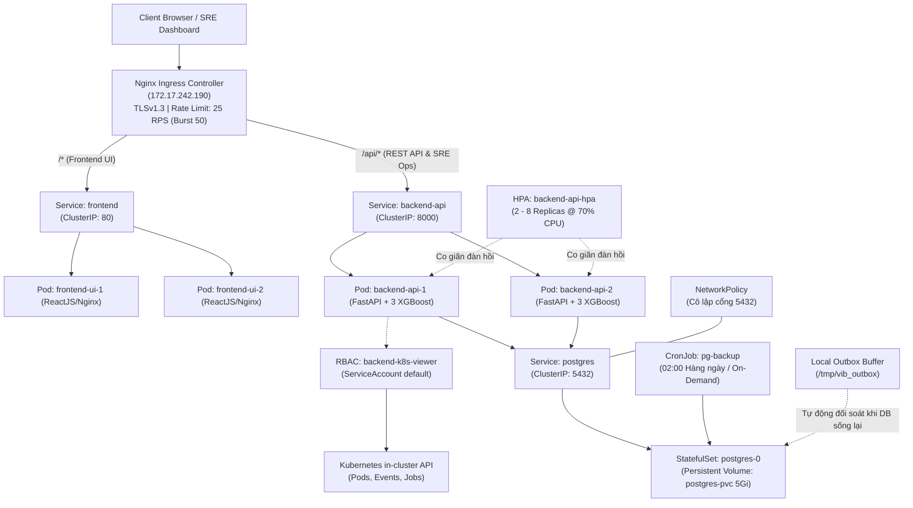

# ☁️ Kiến Trúc & Triển Khai Hạ Tầng Đám Mây (Cloud Infrastructure)

Hạ tầng của hệ thống **VIB-SmartBanking-AI** được thiết kế và vận hành theo mô hình Cloud-Native, hướng tới mục tiêu tối ưu hóa tài nguyên phần cứng, chịu tải cao trong quá trình suy luận mô hình AI (Model Serving), đảm bảo tính sẵn sàng cao (High Availability), an ninh đa tầng và khả năng chịu thảm họa không mất dữ liệu (Disaster Recovery & Zero Data Loss).

---

## 🏛️ 1. Tổng Quan Kiến Trúc Hạ Tầng (Cloud Topology)

Toàn bộ hệ sinh thái dịch vụ được cô lập trong Namespace chuyên biệt `vib-banking` trên nền tảng **K3s (Lightweight Kubernetes)**, quản trị và định tuyến tập trung qua **Nginx Ingress Controller** hỗ trợ mã hóa HTTPS TLSv1.3 và bộ điều tiết tần suất Rate Limiting:



---

## 🛠️ 2. Các Thành Phần Hạ Tầng Đã Triển Khai Hoàn Tất

### 2.1. Cụm Container Orchestration (K3s Cluster)
- **Namespace Isolation**: Tạo và cấu hình namespace riêng biệt `vib-banking` nhằm phân tách tài nguyên, quyền hạn và giám sát.
- **Microservices Deployment**:
  - `frontend`: Container hóa ReactJS build production (Nginx Alpine) phục vụ giao diện người dùng, bảng theo dõi hồ sơ đăng ký và bảng điều khiển SRE Management Dashboard.
  - `backend-api`: FastAPI service nạp sẵn (preload) 3 mô hình học máy XGBoost vào bộ nhớ RAM thông qua cơ chế `lifespan` nhằm giảm thiểu tối đa độ trễ suy luận (~3.5ms).
  - `postgres-0`: Triển khai dưới dạng StatefulSet gắn kèm Persistent Storage (PVC 5Gi) lưu trữ 290.223 hồ sơ khách hàng dưới dạng JSONB Feature Store.

### 2.2. Cân Bằng Tải & Cổng Vào Bảo Mật (Ingress, TLS & Rate Limiting)
- **Nginx Ingress Controller**: Đóng vai trò là API Gateway duy nhất tại địa chỉ IP của Node (`172.17.242.190`).
- **Path-based Routing**: Phân luồng traffic tự động: `/api/*` về cụm backend và `/*` về giao diện frontend.
- **Mã hóa Toàn Trình (HTTPS TLSv1.3)**: Gắn kèm Secret `vib-tls-secret` kích hoạt chứng chỉ SSL/TLS và tiêu đề bảo mật HSTS (`Strict-Transport-Security`).
- **Điều Tiết Tần Suất (Rate Limiting)**: Cấu hình `limit-rps: 25` và `limit-burst-multiplier: 2` (Burst 50 requests) nhằm ngăn chặn triệt để tấn công vét cạn (brute-force) và DoS/DDoS.

### 2.3. Tự Động Co Giãn Đàn Hồi (Horizontal Pod Autoscaler - HPA)
- **Resource Limits**: Thiết lập `requests` (CPU 200m, RAM 512Mi) và `limits` (CPU 1000m, RAM 1Gi) cho từng container backend.
- **Chính sách co giãn**:
  - Tự động co giãn từ **2 đến 8 Replicas** dựa trên mức sử dụng CPU trung bình (**70%**).
  - Kết nối Kubernetes Metrics Server thu thập dữ liệu thời gian thực.
  - Tích hợp endpoint thử tải `/api/ops/stress-test` (burst 60 phép tính AI song song) để kích hoạt và kiểm chứng HPA.

### 2.4. Độ Sẵn Sàng Cao & Cập Nhật Không Gián Đoạn (High Availability & Zero-Downtime)
- **RollingUpdate Strategy**: Thiết lập `maxUnavailable: 0` và `maxSurge: 1` đảm bảo luôn có Pod mới sẵn sàng trước khi Pod cũ bị tắt.
- **PodDisruptionBudget (PDB)**: Cấu hình `minAvailable: 1` cho cả hai tầng frontend và backend, bảo vệ hệ thống không bị sập khi thực hiện bảo trì node (`kubectl drain`).
- **Health Probes**:
  - `livenessProbe` (`/health`): Tự động restart container nếu luồng backend bị deadlock/treo.
  - `readinessProbe` (`/ready`): Chỉ cho phép Ingress điều hướng lưu lượng khi 3 mô hình XGBoost đã nạp hoàn chỉnh vào RAM.

### 2.5. Cơ Chế Chịu Lỗi Thảm Họa & Bảo Toàn Dữ Liệu (Disaster Recovery & Zero Data Loss)
- **StatefulSet & Persistent Storage**: Gắn PVC 5Gi bảo toàn dữ liệu khách hàng qua mọi lần khởi động lại hoặc recreate Pod.
- **Outbox Pattern**:
  - Khi cơ sở dữ liệu ngắt kết nối, các đơn đăng ký dịch vụ từ xa được bắt ngoại lệ và lưu tạm vào bộ đệm tệp cục bộ `/tmp/vib_outbox` (`HTTP 202 Accepted`).
  - Tiến trình ngầm `vib_outbox_reconciler` tự động phát hiện khi DB hoạt động trở lại và nạp bù toàn bộ đơn vào PostgreSQL.
- **Sao Lưu Tự Động Định Kỳ & On-Demand**:
  - CronJob `pg-backup` tự động tạo bản snapshot nén `.sql.gz` vào lúc 02:00 mỗi ngày, lưu trữ 7 ngày.
  - Cung cấp API `POST /api/ops/trigger-backup` để SRE có thể kích hoạt sao lưu tức thì trước các đợt phát hành lớn.

### 2.6. Cô Lập Mạng & Bảo Vệ Dữ Liệu Khách Hàng (NetworkPolicy & Anti-IDOR)
- **Kubernetes NetworkPolicy**: Áp dụng luật cô lập cổng 5432 của PostgreSQL, chỉ cho phép traffic đến từ các Pod có nhãn `app=backend-api` và `app=pg-backup`. Mọi Pod khác trong cụm (kể cả pod do kẻ tấn công chiếm quyền) đều bị chặn 100%.
- **Phòng chống IDOR (Insecure Direct Object Reference)**: Xác thực nghiêm ngặt JWT Claim, ngăn chặn hành vi truy xuất hồ sơ và giao dịch của khách hàng khác (`HTTP 403 Forbidden`).

### 2.7. Quyền Hạn Trong Cụm (In-Cluster RBAC) & Bảng Điều Khiển SRE
- Khởi tạo `Role` và `RoleBinding` `backend-k8s-viewer` cho ServiceAccount `default`.
- Cho phép Backend API truy vấn trực tiếp Kubernetes in-cluster API (`/api/v1/namespaces/vib-banking/pods`, `/events`, `/apis/batch/v1/cronjobs`) để cung cấp dữ liệu sống cho bảng điều khiển **Quản trị Hạ tầng Cloud (`/admin/infrastructure`)**.

---

## 📋 3. Bảng Tổng Hợp Tài Nguyên Kubernetes Đã Khởi Tạo

| Loại Tài Nguyên (Kind) | Tên Tài Nguyên | Namespace | Mô tả chức năng |
|---|---|---|---|
| **Namespace** | `vib-banking` | - | Cô lập toàn bộ tài nguyên dự án |
| **Secret** | `vib-secrets` | `vib-banking` | Lưu trữ mật khẩu DB, JWT Secret mã hóa |
| **Secret** | `vib-tls-secret` | `vib-banking` | Chứng chỉ SSL/TLS phục vụ HTTPS Ingress |
| **Ingress** | `vib-ingress` | `vib-banking` | Gateway định tuyến `/*`, `/api/*`, TLS & Rate Limit |
| **Service** | `backend-api` | `vib-banking` | Cân bằng tải nội bộ cho cụm Backend (Port 8000) |
| **Service** | `frontend` | `vib-banking` | Cung cấp UI ReactJS (Port 80) |
| **Service** | `postgres` | `vib-banking` | Kết nối nội bộ tới cơ sở dữ liệu (Port 5432) |
| **Deployment** | `backend-api` | `vib-banking` | Quản lý cụm Pod FastAPI / AI Engine (2 - 8 pods) |
| **Deployment** | `frontend` | `vib-banking` | Quản lý cụm Pod Web UI Nginx (2 pods) |
| **StatefulSet** | `postgres` | `vib-banking` | Cơ sở dữ liệu lưu trữ 290k hồ sơ đặc trưng |
| **PersistentVolumeClaim** | `postgres-pvc` | `vib-banking` | Ổ đĩa lưu trữ bền vững 5Gi cho PostgreSQL |
| **PersistentVolumeClaim** | `pg-backups` | `vib-banking` | Ổ đĩa lưu trữ các bản snapshot sao lưu `.sql.gz` |
| **ConfigMap** | `backend-override` | `vib-banking` | Nạp đè cấu hình router AI, Auth, Applications & SRE Ops |
| **ConfigMap** | `frontend-assets` | `vib-banking` | Nạp bundle giao diện SRE Dashboard & Dashboard mới |
| **HPA** | `backend-api-hpa` | `vib-banking` | Tự động co giãn theo tải tính toán CPU (70%) |
| **PodDisruptionBudget** | `backend-pdb`, `frontend-pdb` | `vib-banking` | Đảm bảo luôn duy trì tối thiểu 1 Pod khả dụng |
| **NetworkPolicy** | `postgres-netpol` | `vib-banking` | Cô lập bảo mật cổng DB 5432 |
| **CronJob** | `pg-backup` | `vib-banking` | Tự động sao lưu database hàng ngày |
| **Role & RoleBinding** | `backend-k8s-viewer` | `vib-banking` | Cấp quyền đọc Pods/Events cho SRE Dashboard |

---

## 🚀 4. Lệnh Vận Hành & Kiểm Tra Nhanh (Cheatsheet)

```bash
# 1. Kiểm tra trạng thái toàn bộ tài nguyên trong cụm
kubectl get all,ing,hpa,cm,secret,pdb,netpol,cronjob -n vib-banking

# 2. Giám sát mức tiêu thụ tài nguyên thực tế của các Pods
kubectl top pods -n vib-banking

# 3. Theo dõi hành vi tự động co giãn của HPA trong thời gian thực
kubectl get hpa -n vib-banking -w

# 4. Chạy bộ kiểm thử tự động toàn diện 22 bài
python3 scripts/test_master.py --url http://172.17.242.190

# 5. Chạy bộ kiểm tra an ninh mạng đa tầng
python3 scripts/test_security.py --url http://172.17.242.190
```
