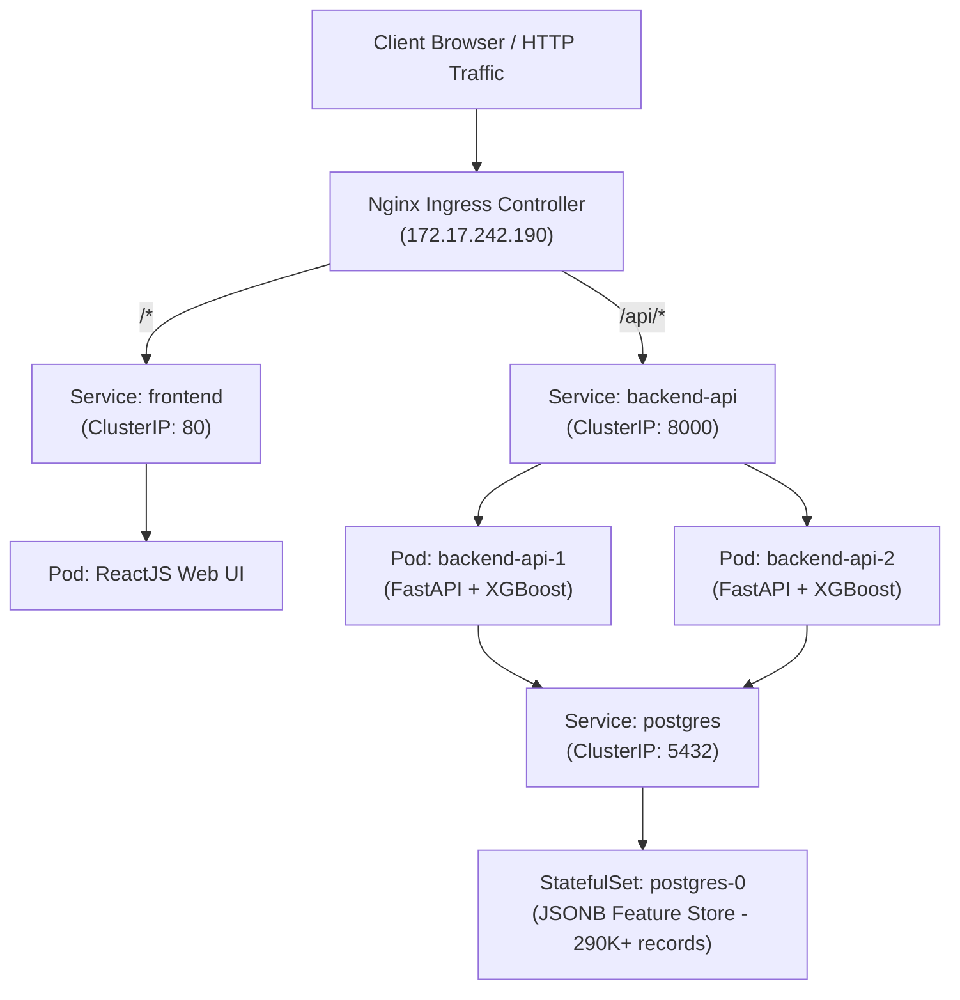

# ☁️ Kiến Trúc & Triển Khai Hạ Tầng Đám Mây (Cloud Infrastructure)

Hạ tầng của hệ thống **VIB-SmartBanking-AI** được thiết kế và vận hành theo mô hình Cloud-Native, hướng tới mục tiêu tối ưu hóa tài nguyên phần cứng, chịu tải cao trong quá trình suy luận mô hình AI (Model Serving) và đảm bảo tính sẵn sàng (High Availability).

---

## 🏛️ 1. Tổng quan Kiến trúc Hạ tầng (Architecture Overview)

Toàn bộ hệ sinh thái dịch vụ được cô lập trong Namespace chuyên biệt `vib-banking` trên nền tảng **K3s (Lightweight Kubernetes)**, quản trị và định tuyến tập trung qua **Nginx Ingress Controller**.




---

## 🛠️ 2. Các Thành phần Đã Triển Khai Hoàn Tất

### 2.1. Cụm Container Orchestration (K3s Cluster)
- **Namespace Isolation**: Tạo và cấu hình namespace riêng biệt `vib-banking` nhằm phân tách tài nguyên, quyền hạn và giám sát.
- **Microservices Deployment**:
  - `frontend`: Container hóa ReactJS build production (Nginx-based serving) phục vụ giao diện người dùng và bảng điều khiển MLOps/AI Insights.
  - `backend-api`: FastAPI service tải sẵn (preload) 3 mô hình học máy XGBoost vào bộ nhớ thông qua cơ chế `lifespan` nhằm giảm thiểu tối đa độ trễ suy luận (Inference Latency).
  - `postgres-0`: Triển khai dưới dạng StatefulSet gắn kèm Persistent Storage để lưu trữ tập dữ liệu 290.223 khách hàng và log đề xuất.

### 2.2. Cân Bằng Tải & Định Tuyến (Load Balancing & Ingress Routing)
- **Nginx Ingress Controller**:
  - Đóng vai trò là API Gateway duy nhất tại địa chỉ IP của Node (`172.17.242.190`).
  - Phân luồng traffic tự động: định tuyến toàn bộ request `/api/*` về cụm backend và `/*` về giao diện frontend.
  - Cấu hình cân bằng tải (Round-Robin/Least Connections) giữa các bản sao (Replicas) của Pod Backend.

### 2.3. Quản Trị Cấu Hình Động (Configuration Management)
- **Kubernetes ConfigMap (`backend-override`)**:
  - Áp dụng kỹ thuật Mount Volume động (`subPath`) để chèn cấu hình và router trực tiếp vào container mà không làm gián đoạn hệ thống.
  - Tối ưu hóa chu trình AI Serving: loại bỏ các tầng kiểm tra phụ thuộc không cần thiết, tối ưu hóa truy vấn JSONB vào PostgreSQL và truyền trực tiếp dữ liệu đặc trưng vào bộ suy luận AI XGBoost.

### 2.4. Khả Năng Giám Sát Sức Khỏe (Health Checks & Probes)
- **Liveness & Readiness Probes**:
  - Endpoint `/health`: Kiểm tra tiến trình backend có còn hoạt động hay không để Kubernetes tự phục hồi (Self-healing) khi xảy ra sự cố.
  - Endpoint `/ready`: Xác nhận 3 mô hình XGBoost đã được nạp hoàn chỉnh vào RAM trước khi Nginx Ingress cho phép nhận traffic, hạn chế triệt để lỗi `502 Bad Gateway` khi Pod mới khởi động.

### 2.5. Cơ Chế Tự Động Co Giãn Ngang (Horizontal Pod Autoscaler - HPA)
- **Resource Management**: Thiết lập `requests` và `limits` (CPU & Memory) cho từng container backend để ngăn chặn cạn kiệt tài nguyên (OOM/CPU Throttling).
- **HPA Policy**:
  - Theo dõi tài nguyên thời gian thực thông qua Kubernetes Metrics Server.
  - Tự động co giãn số lượng Pod backend (từ **2** lên đến **5–6 Replicas**) dựa trên ngưỡng sử dụng CPU trung bình (**70%**), đáp ứng tốt các đợt tăng đột biến lưu lượng tính toán AI (Stress Test).

---

## 📋 3. Bảng Tổng Hợp Tài Nguyên K8s Đã Khởi Tạo

| Loại Tài Nguyên (Kind) | Tên Tài Nguyên | Namespace | Mô tả chức năng |
|---|---|---|---|
| **Namespace** | `vib-banking` | - | Cô lập toàn bộ tài nguyên dự án |
| **Ingress** | `vib-ingress` | `vib-banking` | Gateway định tuyến `/` và `/api` |
| **Service** | `backend-api` | `vib-banking` | Cân bằng tải nội bộ cho API |
| **Service** | `frontend` | `vib-banking` | Cung cấp UI ReactJS |
| **Service** | `postgres` | `vib-banking` | Kết nối nội bộ tới cơ sở dữ liệu |
| **Deployment** | `backend-api` | `vib-banking` | Quản lý vòng đời cụm Pod FastAPI/AI Engine |
| **Deployment** | `frontend` | `vib-banking` | Quản lý Pod UI Nginx |
| **StatefulSet** | `postgres` | `vib-banking` | Cơ sở dữ liệu lưu trữ 290k hồ sơ đặc trưng |
| **ConfigMap** | `backend-override` | `vib-banking` | Nạp đè cấu hình router AI & Auth linh hoạt |
| **HPA** | `backend-api-hpa` | `vib-banking` | Tự động co giãn theo tải tính toán CPU |

---

## 🚀 4. Lệnh Vận Hành & Kiểm Tra Nhanh (Cheatsheet)

```bash
# Kiểm tra toàn bộ trạng thái các tài nguyên trong cụm
kubectl get all,ing,hpa,cm -n vib-banking

# Giám sát mức tiêu thụ tài nguyên thực tế của các Pods
kubectl top pods -n vib-banking

# Giám sát hành vi tự động co giãn của HPA trong thời gian thực
kubectl get hpa -n vib-banking -w